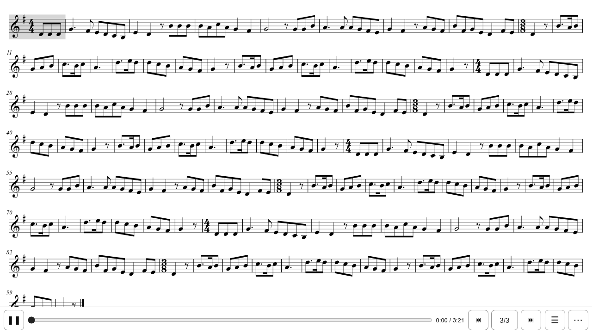
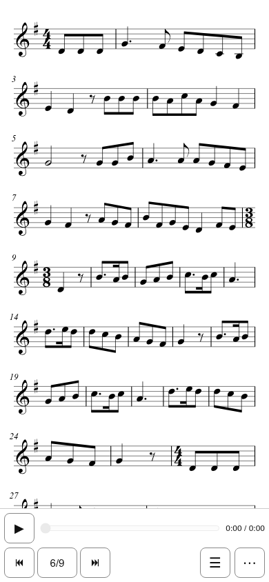
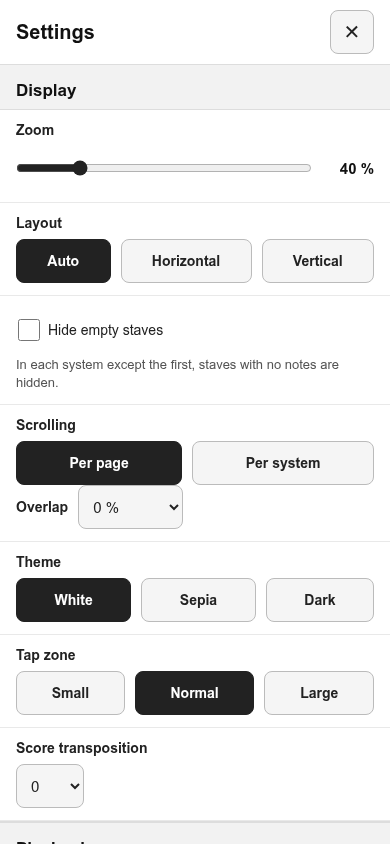

# Cantus

Cantus is a free sheet music reader that runs in the browser and works offline. It displays scores in MusicXML and several other formats, plays them back, and keeps a library of the scores you open on your own device. You can use it as a web page or install it as an app.

**Open Cantus: <https://jperon.github.io/cantus/>**



<p>
  
  
</p>

*De âlde Friezen (CC0), the score used in these screenshots.*

## What you can do

### Open scores

Cantus opens:

- MusicXML: `.xml`, `.musicxml`, and compressed `.mxl`
- MuseScore: `.mscz`, `.mscx`
- LilyPond: `.ly`, `.lilypond`
- ABC: `.abc`
- MIDI: `.mid`, `.midi`
- GABC (Gregorian square-note notation): `.gabc`

Use **Open a file** or **Open a folder**. A folder, or a selection of several files, becomes one library item; LilyPond files pulled in by `\include` stay with the piece they belong to.

When Cantus is installed on Android, you can share one or more scores to it from another app.

MuseScore, LilyPond, ABC and MIDI files are converted by the optional scoretk converter. MIDI carries no notation, so Cantus shows an automatic transcription and tells you so.

GABC files open by default in square-note notation, typeset by exsurge without scoretk or Verovio. Their title, mode and initial are shown, and each line of chant is one page. In that view playback and export are not available.

A **Gregorian** toggle button switches a GABC score to classical notation and back; its pressed state shows which notation is active. The classic view converts the file to MusicXML with scoretk, so it uses the same pagination, playback, transposition, tempo and export as any other MusicXML score. It requires the optional scoretk package. The choice is remembered per library item, for every GABC file in a mixed folder, and the reading position is kept across the switch.

### Read

- Turn pages by tapping the left or right side of the score, with the left/right arrow keys or Space, or with the page-number button.
- Choose **Layout**: **Auto**, **Horizontal** or **Vertical**.
- Scroll **Per page** or **Per system**, with an adjustable **Overlap**.
- Set **Zoom** from 30 % to 80 %, **Hide empty staves**, and a **Theme**: **White**, **Sepia** or **Dark**.
- Set the **Tap zone** to **Small**, **Normal** or **Large**.
- Scores with several movements are split at their movement boundaries; use the previous/next movement buttons.

### Listen

- Play or pause with the ▶ button or the `p` key, seek with the slider, and set the **Master volume**.
- **Follow scrolling** keeps the page in view during playback; **Highlight the current measure** marks the measure being played.
- **Playback tempo** is adjustable from 20 to 300 per minute in the file's beat unit. **File tempo** returns to the tempo written in the score, or to the default when the score has none.
- **Expand repeats** follows repeats, D.C./D.S., codas and endings; turn it off for a straight reading in written order.
- **Piano only** plays all melodic parts with a piano sound.

### Parts

For each part you can hide it from the score, mute it during playback, and change its **Size**, **Volume** and **Instrument** (General MIDI). **Score transposition** and **Sound transposition** move the written score and the sound independently, from −12 to +12 semitones.

### Library

Scores you open are saved in the browser, with their reading position. The **Library** lists them and the home screen shows the **Recent** ones. You can delete one score and undo the deletion, or use **Clear all** to remove the whole library. **Clear cache** in Settings only clears rendering caches, not the saved scores.

### Export

The **Export** menu writes the open score to MusicXML, Compressed MusicXML, MuseScore (`.mscx`/`.mscz`), LilyPond, ABC or MIDI. The dialog lists the formats the bundled converter can write.

### Languages

The interface is available in English, French, Spanish, Italian and German. It starts in the browser's language when a translation exists, otherwise in English, and you can change it in Settings without reloading.

## Getting started

1. Open <https://jperon.github.io/cantus/>.
2. Choose **Open a file** or **Open a folder**, or pick a score from **Recent** or the **Library**.
3. Turn pages by tapping the sides of the screen; open the page-number button to jump to a page.
4. Press ▶ to listen. Adjust tempo, repeats, transposition and parts in **Settings**.
5. To install, use **Install Cantus** or your browser's install command. Chrome and Edge may offer it after a few visits; in Firefox, use the install icon in the address bar; in Safari, use **Share > Add to Home Screen**.
6. After the first visit, the app is cached and opens offline. Your library and reading positions stay on the device.
7. When a new version is available, Cantus offers **Update** or **Later**.

### One-file version

The ready-to-use single-file version is available at <https://jperon.github.io/cantus/spa.html> (about 25 MB). It is one HTML file with the application, the engraver, the converter and the sound samples inside. Everything it needs is in that file, so it can be kept and opened on its own. You can also build it; see the build instructions below.

## Privacy

Cantus has no account, no advertising and no analytics. Your scores and reading positions are stored in your browser's storage on your device; they are not uploaded.

The app makes network requests for its own files: the page, scripts, sound samples and updates to the app itself. The only other request is the one you ask for by opening a remote `http(s)` address through the `?file=` parameter, or through a link that uses it. Links in the About section are ordinary links to external sites.

## Known limitations

- **Optional converter.** Builds made without the scoretk package can open MusicXML, MXL and GABC in square-note notation only, and cannot export. MuseScore, LilyPond, ABC and MIDI import, and the classic view of GABC, require it.
- **MIDI is a transcription.** A MIDI file contains no notation, so the score you see is generated from the notes.
- **Playback details.** Fermata and breath marks are ignored, and a two-chord tremolo sounds from its first chord only.
- **Remote `?file=` links.** A remote `?file=` address is read as plain text, so only uncompressed MusicXML works, and the remote server must allow access from other sites.
- **Browser installation.** Installation and "Open with" support depend on the browser; in Safari, installation goes through **Add to Home Screen**.

## Build from source

The reference build uses the Nix flake:

```sh
nix develop
nix run .#build       # site in dist/
nix run .#build-spa   # single file in dist/spa.html
nix run .#test        # unit and Playwright tests
```

The build needs the Verovio toolkit at `../partitura/verovio-toolkit-wasm.js`. The scoretk package at `../musescore/result/classic` (or `SCORETK_PKG`) is optional but enables the extra import and export formats and the classic view of GABC. `BUILD.md` has the full instructions; it is written in French.

## Contributing and reporting

The source code and issue tracker are at <https://github.com/jperon/cantus>. Bug reports, score files that fail to open, and pull requests are welcome. Run `nix run .#test` before sending a change.

## License and credits

Cantus is free software under the GNU GPL v3 or later; see [LICENSE](LICENSE). It uses:

- Verovio for music engraving (LGPL-3.0-or-later);
- exsurge for Gregorian square-note notation from GABC (MIT);
- fflate for compressed MusicXML (MIT);
- MuseScore_General sound samples (MIT);
- Cantus Serif, based on Liberation Serif (SIL Open Font License 1.1);
- scoretk, when included, for MuseScore, LilyPond, ABC, MIDI and GABC conversion (GPL-3.0-only).

See [THIRD-PARTY.md](THIRD-PARTY.md) for the full notices.
